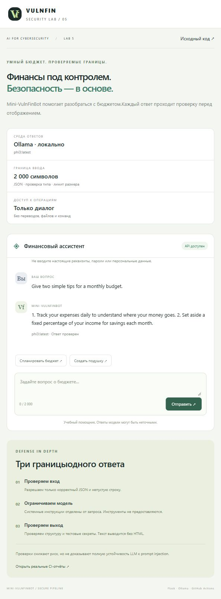
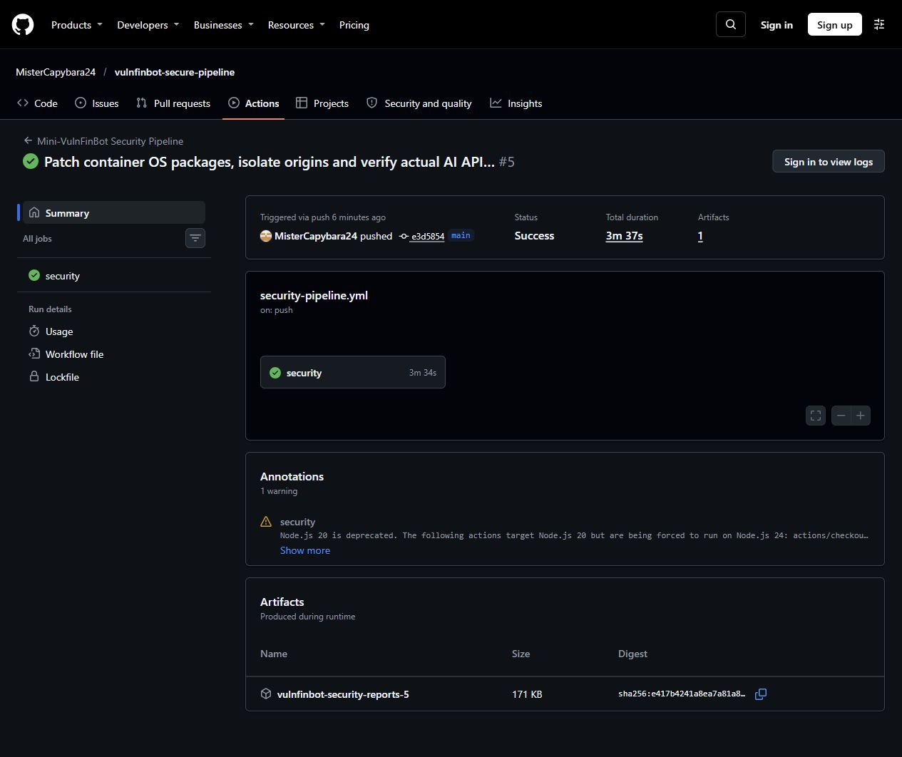
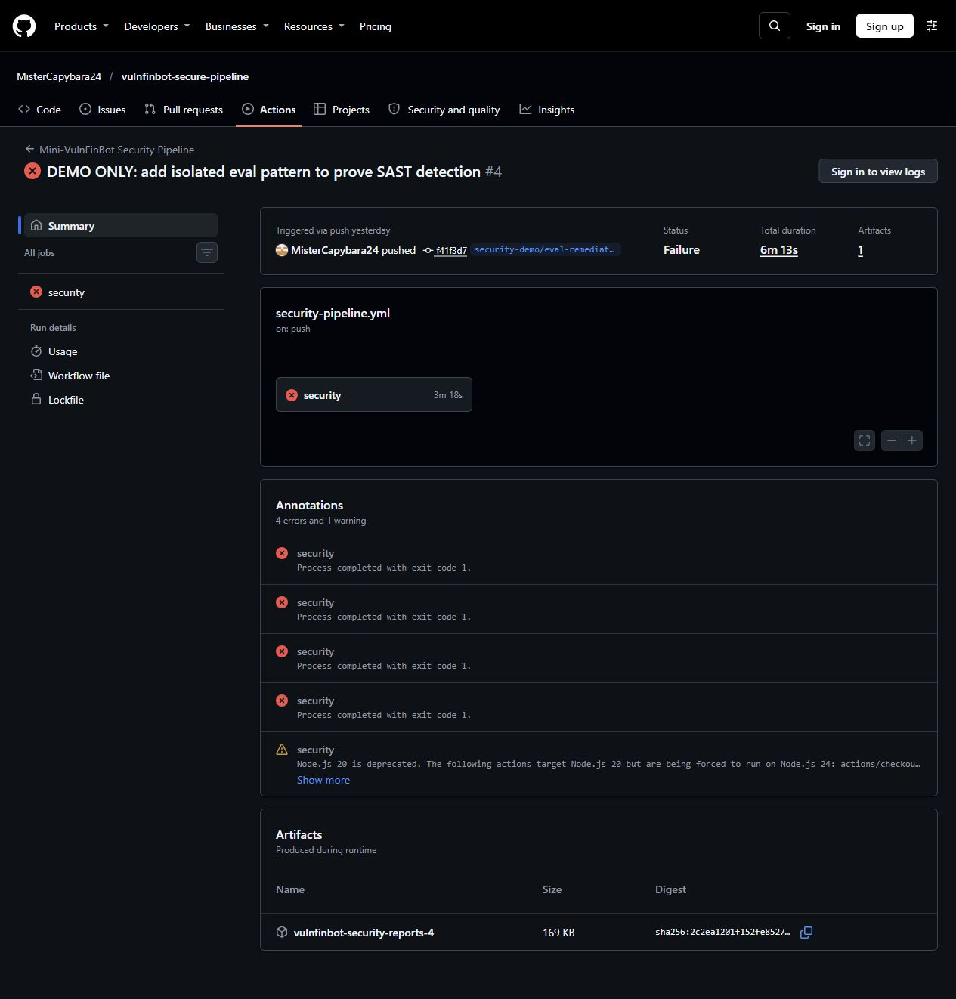
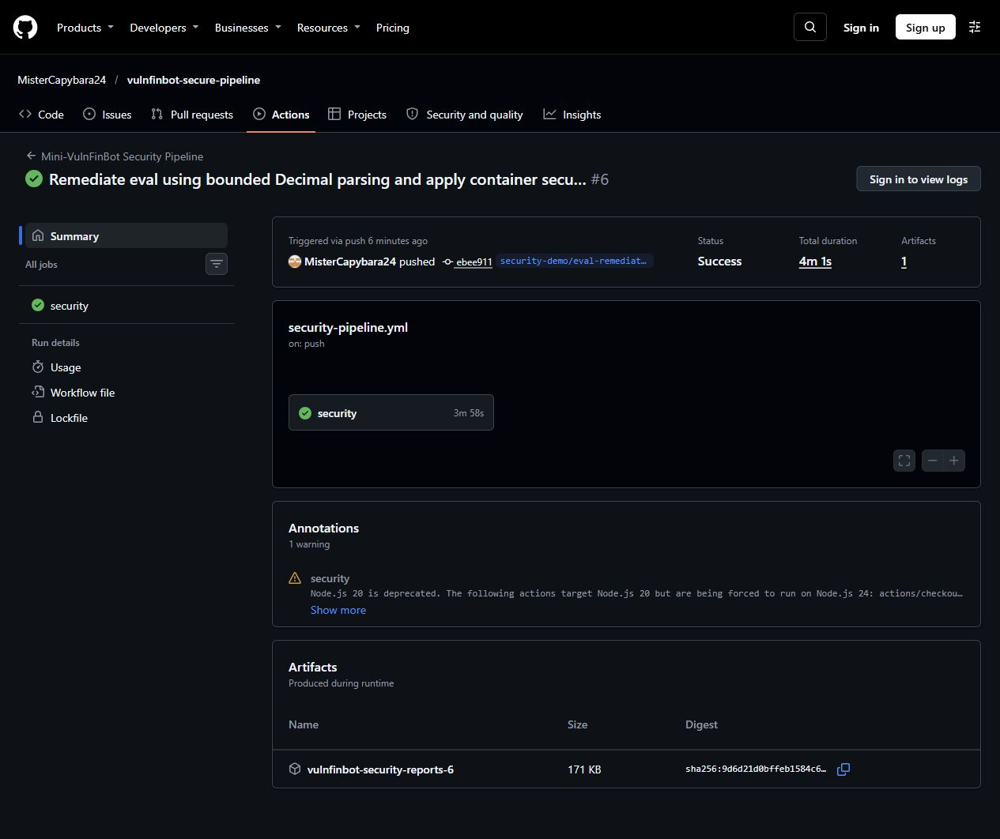

# Скриншоты реального выполнения

## Приложение

## Настоящий ответ Ollama

## Остановка instruction override

## Основная ветка после исправлений

## Демонстрационная ветка до и после

Это снимки работающего приложения и страниц GitHub Actions, а не макеты. Подробнее о проверенных коммитах, результатах и ограничениях — в [техническом отчёте](../technical-report.md).
