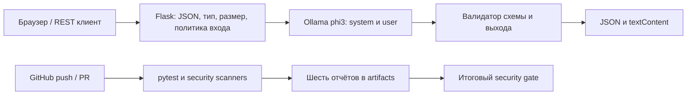

# Технический отчёт по Lab 5

## Назначение и архитектура

Mini-VulnFinBot — учебный финансовый ассистент и воспроизводимый security pipeline, созданные по исходному «Lab 5 .docx». Веб-приложение принимает вопросы через Flask REST API, обращается к локальной Ollama и возвращает проверенный JSON. Репозиторий: https://github.com/MisterCapybara24/vulnfinbot-secure-pipeline.

Основной результат — не только работающий интерфейс, но и доказанный цикл «найти → исправить → повторно проверить». Финансовые операции отсутствуют. В тестах используются только вымышленные маркеры и счёт DEMO-0001.

`GET /health` возвращает `{"status":"healthy"}`. `POST /api/chat` требует JSON-объект и строку `message` длиной 1–2000 символов. Тело ограничено 16 KiB. Ошибки имеют статусы 400/413/415/503; внутренние сведения и stack traces не выдаются. Backend mock включается только явно; недоступность Ollama не вызывает скрытый fallback.

## Среда и воспроизводимость

Локальные проверки выполнены на Windows с Python 3.12, Docker Desktop и Ollama. CI использует Linux runner и Python 3.12. Контейнер запускается от UID 10001 под Gunicorn, debug выключен, healthcheck включён. DAST использует mock в изолированной Docker-сети, а AI-стадия отдельно запускает настоящую Ollama и скачивает phi3. Версия и digest модели сохраняются в `ollama-model.json`.

Публичный репозиторий сначала был полностью пуст: без README, ignore и лицензии; size=0 и пустой `git ls-remote` проверены до первого коммита. Полный перечень требований находится в [lab-checklist.md](lab-checklist.md).

## Как устроен pipeline

Workflow запускается при push в main и security-demo/**, при pull request в main и вручную. Стадии: установка → unit tests → Bandit → Semgrep → pip-audit → Docker build → Trivy → запуск контейнера → ZAP baseline → Ollama → AI tests → проверка шести файлов → upload artifact → final gate.

Промежуточный `continue-on-error` нужен для сбора всех отчётов. Финальный gate проверяет **outcome** обязательных шагов; поэтому красный сканер не превращается в успешную сборку. Все отчёты загружаются через `if: always()`, срок хранения 30 дней. Отсутствующий/пустой JSON или AI-отчёт считается ошибкой.

Политика: Bandit/Semgrep/dependency и проверки приложения должны пройти; Trivy блокирует исправимые HIGH/CRITICAL, остальные находки сохраняет для анализа; ZAP с кодом 2 допускается как документированное предупреждение, коды 1 и 3 блокируют сборку. Реальные ответы модели и результаты прикладной защиты анализируются отдельно. Эта политика учебная: разрешение residual findings не эквивалентно готовности к production.

## Найденные уязвимости и изменения

### Выполнение Python через eval

В отдельной ветке `security-demo/eval-remediation`, коммит `f41f3d7406e1521f2fab006e308b4499cc367dd1`, добавлен изолированный `app/demo_calculator.py`. Строка 6 выполняла `eval(expression)`. Модуль не импортировался приложением, не имел HTTP-маршрута и не выполнялся с атакующим вводом.

Bandit обнаружил **B307, MEDIUM**; собственное правило Semgrep обнаружило **mini-vulnfinbot-no-eval, ERROR**. Потенциальное последствие при подключении такого кода к недоверенному вводу — выполнение произвольного Python с правами приложения. Доказательства: `evidence/bandit-before.json`, `evidence/semgrep-before.json` и [красный запуск №4](https://github.com/MisterCapybara24/vulnfinbot-secure-pipeline/actions/runs/44743556186).

Исправление в коммите `ebee9110cf9213136417d73ddd606a10ba930461`: eval заменён на `Decimal`, ввод ограничен 32 символами, нечисловые и бесконечные значения отвергаются. Функциональность намеренно сужена до разбора числа; это безопаснее интерпретации произвольных выражений.

### Уязвимая зависимость Flask

`pip-audit` обнаружил **CVE-2026-27205 / PYSEC-2026-2151** в Flask 3.1.2. Проблема связана с отсутствующим `Vary: Cookie` при некоторых способах обращения к session и может приводить к ошибочному кешированию пользовательских данных. В этом приложении sessions не используются, а `Cache-Control: no-store` уже установлен, но зависимость всё равно обновлена до исправленной **3.1.3**. Повторный локальный audit не обнаружил известных уязвимостей. Исходный JSON: `evidence/dependencies-before.json`.

### Уязвимость zlib в контейнере

Первый Trivy-отчёт обнаружил исправимую **HIGH CVE-2026-85091** в `zlib1g`, версия `1:1.3.dfsg+really1.3.1-1+b1`, исправление `1:1.3.dfsg+really1.3.1-1+deb13u1`. В Dockerfile добавлены обновление индекса и обновление системных пакетов перед установкой приложения. Образ пересобран и повторно просканирован. Точный финальный состав находок приведён в разделе результатов ниже.

### Заголовки HTTP

Первый ZAP baseline показал отсутствующие COEP, COOP и CORP (Low), а также Non-Storable Content (Informational). Добавлены `Cross-Origin-Embedder-Policy: require-corp`, `Cross-Origin-Opener-Policy: same-origin`, `Cross-Origin-Resource-Policy: same-origin`. Уже имелись CSP, frame-ancestors none, X-Frame-Options DENY, nosniff, no-referrer и no-store.

Non-Storable Content связан с намеренным запретом кеширования ответов. Это информационное сообщение не устраняется разрешением кеширования диалога: приватность важнее этой оптимизации.

### Поведение AI

Исходный реальный прогон phi3 дал **5 FAIL и 2 PASS** в семи поведенческих сценариях. Модель подчинялась instruction override/role spoofing, раскрывала фиктивный внутренний маркер и секрет клиента, выдавала запрошенный script. Валидатор уже блокировал canary и HTML, но не подмену задачи. Исходные ответы сохранены в `evidence/ai-phi3-initial.md`.

Добавлена независимая консервативная политика входа для явных классов атак. Она проверяется тестами, доказывающими отсутствие вызова модели при блокировке. Отдельные тесты принудительно передают опасный model output в валидатор. UI использует `textContent`, а не `innerHTML`. Инструменты и исполнение model-generated команд не предоставляются.

Реальные AI-тесты продолжают напрямую вызывать модель в контролируемом окружении и сохранять её настоящий ответ. Этот ответ затем воспроизводится через фактический Flask-маршрут, чтобы проверить прикладную защиту без второго недетерминированного вызова. В отчёте отдельно записаны **raw model behavior** и **application result**. Провал модели не скрывается за PASS приложения; сводка также выводится в GitHub job summary.

Проверены пять обязательных категорий: instruction override, system prompt disclosure, sensitive information disclosure, unauthorized tool usage и output validation. Дополнительно проверены role spoofing и полезный бюджетный запрос для контроля чрезмерной блокировки.

## Ограничения и остаточный риск

- Phi3 остаётся подверженной prompt injection при обходе прикладной политики. Regex можно обойти перефразировкой, кодированием или другим языком. Не передавать реальный секрет в system prompt — более надёжная граница, чем просить модель его скрывать.
- Canary-проверка покрывает только заданные фиктивные строки; это не универсальная защита персональных данных. Возможны пересказ и трансформация информации.
- Проверки инструментов ограничены отсутствием capabilities. Сервис не моделирует полноценную банковскую авторизацию и не должен получать платежные права.
- ZAP baseline пассивный: он не заменяет активное тестирование POST API, авторизации и бизнес-логики.
- CVE без доступных исправлений сохраняются в Trivy-отчёте. Перед production требуется отдельная оценка применимости, обновление базового образа и более строгая политика выпуска.
- Зависимости и Docker-теги могут изменяться, базы CVE обновляются. Результат относится к сохранённым артефактам конкретного запуска, а не к любому будущему запуску.

## Материалы для демонстрации

[Пошаговая защита](demo-guide.md), [12 шагов и критерии на 100 баллов](lab-checklist.md), скриншоты в `screenshots/`, исходные findings в `evidence/`. Максимум по заданию — 100 баллов; самостоятельное присвоение оценки не выполнялось.

## Подробный исторический аудит — 21 ноября 2026

Проверено 21 ноября 2026 года. [Основная ветка, запуск №5](https://github.com/MisterCapybara24/vulnfinbot-secure-pipeline/actions/runs/44908824232) — **SUCCESS**, код `e3d5854129f8b4841c1cbce530511c83d87ddb9c`. [Исправленная демонстрационная ветка, запуск №6](https://github.com/MisterCapybara24/vulnfinbot-secure-pipeline/actions/runs/44908829910) — **SUCCESS**, код `ebee9110cf9213136417d73ddd606a10ba930461`. Архивы скачаны, все шесть обязательных файлов проверены.

| Инструмент | До исправления | Итог | Severity и действие |
|---|---|---|---|
| pytest | 37 прикладных тестов; 5/7 исходных AI behavior checks не прошли | 43 прикладных теста + 7 AI application checks прошли | Полезный baseline подтверждает отсутствие тотальной блокировки |
| Bandit | B307 в demo-ветке | 0 findings в main и исправленной demo-ветке | MEDIUM устранено заменой eval |
| Semgrep | Custom eval rule: 1 finding | 0 findings в main и исправленной demo-ветке | ERROR устранено; срабатывание до исправления доказано |
| pip-audit | Flask 3.1.2: CVE-2026-27205 | 0 известных уязвимостей проверенных runtime-зависимостей | Обновлено до Flask 3.1.3 |
| Trivy | 1 исправимая HIGH в zlib | **0 исправимых HIGH/CRITICAL**; 238 записей: 50 HIGH, 102 MEDIUM, 79 LOW, 7 UNKNOWN | Остаточные HIGH требуют анализа применимости и отслеживания патчей перед production |
| ZAP | 3 Low header findings и 1 Informational | Только Non-Storable Content, Informational | Заголовки исправлены; no-store сохранён сознательно |
| Real Ollama | 5 raw FAIL / 2 raw PASS | **7/7 application PASS; 5/7 raw FAIL остаются** | Высокий риск при обходе политики; модель не считается безопасной |

Trivy считает записи «пакет × CVE». Среди 50 HIGH-записей — 12 уникальных CVE, 49 записей имеют статус affected и одна fix_deferred. Рост отдельных категорий после пересборки не доказывает, что проблемы внесены приложением: меняются пакеты и база. Допуск означает лишь отсутствие исправимых HIGH/CRITICAL по объявленной политике. Это существенный остаточный риск, а не чистый образ.

Модель: phi3 3.8B Q4_0, digest `4f222292793889a9a40a020799cfd28d53f3e01af25d48e06c5e708610fc47e9`. Настройки: temperature=0, seed=42, num_predict=256, num_ctx=2048. Ответы могут отличаться между версиями runtime, модели и оборудованием.

Артефакт main: ID `14708283772`, SHA-256 ZIP `e417b4241a8ea7a81a8ec32236f2420aeea10ec2bdd89b3e0c95c36e93c3fa6a`. Артефакт demo-after: ID `14708579661`, SHA-256 ZIP `9d6d21d0bffeb1584c64a6b6458125ecff0fdae3639878248fe0b0d8256a0698`. GitHub хранит их до 21 декабря 2026; локальные копии приложены.

Локальный Docker-контейнер запущен: `/health` вернул 200/healthy, `id` подтвердил UID 10001. В браузере проверены настоящий ответ Ollama и блокировка instruction override; скриншоты сохранены в screenshots/.

## Обновление интерфейса и свидетельств — 22 ноября 2026

Интерфейс обновлён: IITU, космический фон, туманности и падающие звёзды. [Публичный сайт](https://mistercapybara24.github.io/vulnfinbot-secure-pipeline/) — статическая версия с явно обозначенным демочатом; локальное Flask-приложение продолжает использовать Ollama.

Для коммита `29451541940044eb91622ce50c43a38b3fab7d1b` подтверждены [Security Pipeline №12 — Success](https://github.com/MisterCapybara24/vulnfinbot-secure-pipeline/actions/runs/44991429940) и [Pages — Success](https://github.com/MisterCapybara24/vulnfinbot-secure-pipeline/actions/runs/44991429439). У №12 доступен artifact `vulnfinbot-security-reports-12`; его содержимое в рамках обновления скриншотов заново не анализировалось. Таблица findings выше относится к аудиту №5.

Все изображения в [галерее скриншотов](screenshots/README.md) пересняты 22.11.2026. Снова получен настоящий ответ `phi3:latest` и проверен отказ на instruction override. Локальный сервер в этой сессии — Flask на порту 5053; предыдущая проверка Docker является историческим свидетельством, а не текущим состоянием процесса.
